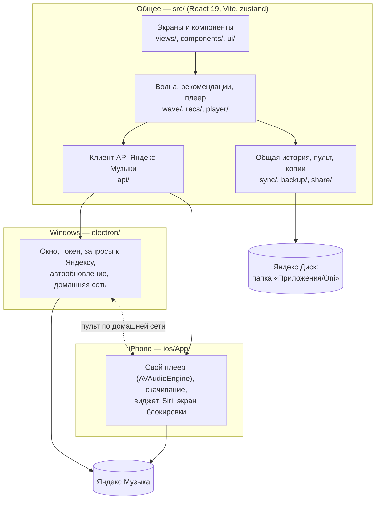

<div align="center">


<br><br>

[](https://github.com/D4SuCE/oni/actions/workflows/check.yml)
[](https://github.com/D4SuCE/oni-releases/releases/latest)
[](#устройство)
[](#устройство)

<br>

[](https://github.com/D4SuCE/oni-releases)

<sub>Здесь — код. Установщики, IPA и описание с картинками — в <a href="https://github.com/D4SuCE/oni-releases">D4SuCE/oni-releases</a>.</sub>

</div>

<br>

# Oni

Неофициальный клиент Яндекс Музыки для Windows и iPhone в японском стиле: «Моя волна» с фильтром повторов
и «Своя волна», подборки в духе Spotify, умные плейлисты, текст в такт, эквалайзер на 10 полос, скачивание
и работа без сети, пульт и общая история ПК ↔ iPhone через Яндекс Диск. Интерфейс на русском и английском.

> Oni не связан с Яндексом. Для полных треков нужна подписка Яндекс Плюс; каждый входит в **свой** аккаунт,
> токен хранится зашифрованным только на устройстве.

**Содержание:** [Два репозитория](#два-репозитория) · [Устройство](#устройство) · [Папки](#папки) ·
[Запуск](#запуск-для-разработки) · [Проверки](#проверки) · [Как вносятся изменения](#как-вносятся-изменения) ·
[Выпуск версии](#выпуск-версии) · [Автоматика на GitHub](#автоматика-на-github)

## Два репозитория

| | Для кого | Что внутри |
| --- | --- | --- |
| **D4SuCE/oni** (этот) | кто хочет понять, как устроено | код, тесты, сборка, план работ |
| **[D4SuCE/oni-releases](https://github.com/D4SuCE/oni-releases)** | кто хочет поставить | установщики Windows, IPA, `sidestore.json`, описание с картинками |

Выпуски лежат отдельно намеренно: установленные программы ищут обновления именно там (Windows — через
`electron-updater`, iPhone — через источник SideStore), и страница скачивания живёт независимо от того,
открыт ли код.

## Устройство

Один интерфейс (React) и общая логика работают на обеих платформах; различается только «нижний этаж»:
как идут запросы, как играет звук и где хранятся файлы.



- **Windows** — Electron. Запросы к Яндексу идут из main-процесса (там нет ограничений браузера), токен
  хранится через `safeStorage`.
- **iPhone** — Capacitor с собственным плеером на Swift: звук идёт через AVAudioEngine и системный эквалайзер,
  поэтому играет в фоне и на экране блокировки. Ставится через SideStore, подробно — [docs/ios-signing.md](docs/ios-signing.md).
- **Два устройства** — история, пульт и резервные копии лежат в папке приложения на Яндекс Диске; пульт
  сначала пробует прямую связь по домашней сети.
- **Рекомендации** — как устроены подборки и фильтры: [docs/recommendations.md](docs/recommendations.md).

## Папки

| Папка | Что внутри |
| --- | --- |
| `src/api/` | клиент API Яндекс Музыки поверх абстрактного `Transport` |
| `src/player/` | воспроизведение, очередь, тексты, ровная громкость, ритм |
| `src/wave/` | «Моя волна» и «Своя волна»: фильтр повторов, история прослушиваний |
| `src/recs/` | подборки, умные плейлисты, «Пропущенное» |
| `src/sync/`, `src/backup/`, `src/share/` | Яндекс Диск: общая история, пульт, копии, «Загруженное» друзей |
| `src/import/` | перенос плейлистов из других сервисов |
| `src/views/`, `src/components/`, `src/ui/` | экраны, компоненты, мелкие помощники интерфейса |
| `src/i18n.ts` | все строки интерфейса (ru, en) |
| `electron/` | Windows: окно, хранение токена, запросы, автообновление, домашняя сеть |
| `ios/App/` | iPhone: плеер, скачивание, виджет, Live Activity, Siri (Swift) |
| `tests/` | офлайн-тесты (`*.test.ts`), e2e реального приложения (`*.mjs`) |
| `scripts/` | выпуск, иконки, снимки и картинки для oni-releases, сторож |
| `watch/` | инструкция облачному сторожу Яндекс Музыки |
| `docs/` | окружение, подпись iPhone, рекомендации, автопилот, архив решений |

План работ — [ROADMAP.md](ROADMAP.md), что изменилось — [CHANGELOG.md](CHANGELOG.md).
Oni разрабатывается вместе с Claude Code: [CLAUDE.md](CLAUDE.md) — правила работы и решения владельца,
которые Claude читает в каждой сессии (и облачные агенты тоже), ROADMAP — где остановились.

## Запуск для разработки

Нужен Node.js 24.

```sh
npm install
npm start          # сборка и запуск приложения
npm run dev        # Vite dev-сервер с горячей перезагрузкой
```

В обычном браузере приложение не работает: запросы к Яндексу идут через Electron. Чтобы открыть
dev-сервер в Electron, задайте `VITE_DEV_URL=http://localhost:5173` и выполните `npm run electron`.
Вход — через окно Яндекса или вставкой OAuth-токена.

Собрать установщик для себя: `npm run dist` → в `release/` появятся `Oni-Setup-<версия>.exe` (установщик)
и `Oni-<версия>-portable.exe` (без установки). Код не подписан, поэтому Windows SmartScreen при первом
запуске может предупредить: «Подробнее» → «Выполнить в любом случае».

## Проверки

```sh
npm run check      # всё быстрое разом: typecheck + lint (oxlint) + офлайн-тесты
npm run test:api   # интеграция с API (нужен YANDEX_MUSIC_TOKEN)
npm run test:e2e   # реальное приложение на реальном аккаунте (нужен YANDEX_MUSIC_TOKEN)
```

e2e ничего не оставляет в аккаунте: лайки, переименования и т. п. откатываются сразу. Один шаг —
`E2E_ONLY=<часть названия>`. Форматтер не запускается: стиль кода — как в соседних файлах, проверка — `npm run lint`.

## Как вносятся изменения

В `main` нельзя писать напрямую — только через pull request:

1. Ветка `feat/…`, `fix/…` или `chore/…` от `main`.
2. PR в `main`. На каждый PR GitHub запускает `check` (типы, lint, офлайн-тесты, сборка); пока она не
   зелёная, слить нельзя. Перед слиянием прогоняется e2e (`npm run test:e2e` или `gh workflow run e2e.yml`),
   а правки iPhone — ещё и облачной сборкой `gh workflow run ios.yml --ref <ветка>`.
3. Слияние — одним коммитом (squash): в истории `main` одна строка на одну задачу. Ветка удаляется сама.

Что поменялось для пользователя — строкой в `CHANGELOG.md` («Не выпущено») в том же PR.
Номер версии в своём PR не меняйте: версии выпускает только владелец репозитория.

## Выпуск версии

Номер версии — в `package.json`. Выпускает только владелец (сливать PR в `main` может только он). Выпуск — такой же PR:

1. Раздел `## [x.y.z] — <дата>` в CHANGELOG из пунктов «Не выпущено», ссылки внизу файла.
2. `npm version x.y.z --no-git-tag-version`.
3. PR с названием **«Release x.y.z»** → слияние.

Дальше всё делает GitHub: `tag-release.yml` ставит метку `vx.y.z` и запускает сборки, `release.yml` собирает
Windows и выкладывает в oni-releases, дожидается IPA из `ios.yml`, прикладывает его и добавляет версию
в `sidestore.json`. Через несколько часов программы обновятся: на Windows — сами (проверка при запуске и
раз в 6 часов, установка при выходе), на iPhone — через SideStore. Portable-версия сама не обновляется.

Запасной путь с ПК — `npm run release` (собрать и выложить вручную).

## Автоматика на GitHub

| Файл | Когда | Что делает |
| --- | --- | --- |
| `check.yml` | каждый push и PR | типы, lint, офлайн-тесты, сборка — обязательна для слияния |
| `tag-release.yml` | слит «Release x.y.z» | метка версии, запуск сборок |
| `release.yml` | метка `v*` | Windows-сборка → oni-releases, IPA, `sidestore.json` |
| `ios.yml` | метка или вручную | IPA для iPhone; вручную — проверка на симуляторе |
| `e2e.yml` | вручную | e2e на Windows-машине GitHub |
| `screens.yml` | вручную | снимки экранов iPhone для oni-releases |
| `ym-watch.yml` | каждый день | сторож: новая версия приложения Яндекс Музыки и проверка API |
| `token-check.yml` | вручную | хватает ли прав у токена выпусков |

Сторож Яндекс Музыки ([watch/AGENT.md](watch/AGENT.md)) — облачный агент: разбирает, что поменял Яндекс,
и правит Oni только если доказал, что без правки он сломается. Остальное — идеи в ROADMAP.

---

<sub>Лицензия не указана: код открыт для просмотра, но все права сохранены. Яндекс Музыка — товарный знак ООО «Яндекс».</sub>
